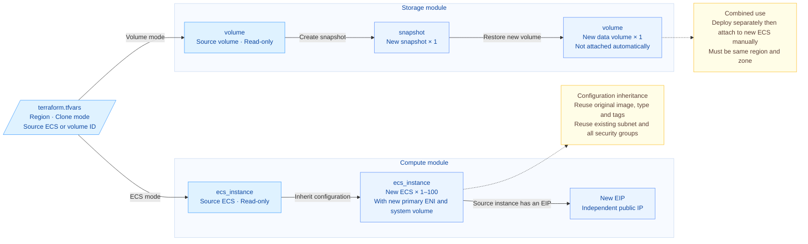

# Fast ECS and Volume Cloning

This template provides ECS configuration cloning and single data-volume cloning within the same region. Supply a source ECS ID and a new login password to create new instances that reuse the original image, instance type and existing network. Supply a source volume ID to create a new data volume through a snapshot. The two modes can be used independently, or deployed separately and attached manually to assemble an environment with a new ECS and data volume.

## 1. Business Background

Building a new environment from existing cloud resources commonly involves the following problems:

- **Repeating instance configuration**: instance type, image, network and system-volume parameters must be filled in one by one, which easily deviates from the source environment.
- **Copying data alone**: when only the data on a specific volume is needed, you want to generate an independent new volume directly, without creating an extra instance.
- **Preserving the source environment**: new resources should have independent instances, volumes and addresses, while the source ECS, source volumes and existing network remain in use.

This solution packages instance configuration cloning and single-volume cloning into two modules, selected and deployed through one entry point. It reduces repeated configuration and uses Terraform to manage the lifecycle of the new resources.

## 2. Solution Overview

The solution is divided into a compute module and a storage module; each deployment selects one mode:

- **ECS configuration cloning**: read the source instance configuration, reuse the existing subnet and security groups, and create 1–100 new ECS instances from the original image. When the source instance has an EIP, apply for an independent EIP for each new instance.
- **Single-volume cloning**: create a snapshot for the specified source volume, then create one unattached new data volume from the snapshot, inheriting the source volume's capacity, type and availability zone by default.
- **Combined use**: deploy the new ECS and new volume separately, then attach manually once the resources are ready; the target ECS and new volume must be in the same region and availability zone.



ECS mode inherits the source instance's instance type, availability zone, original image, network, system-volume specification, billing settings, project, tags and deletion protection. New instance names automatically receive suffixes such as `-clone-001`, log in with the new password, and have independently generated instance IDs, primary interfaces, system volumes and private IPs; new EIPs use independent public addresses.

System-volume contents come from the original image. Software, configuration and files added later on the source instance, as well as currently attached data volumes, are not copied by ECS configuration cloning; data volumes included in the original image are created according to the image definition. Use single-volume cloning mode when you need to copy the data of a specific volume. Secondary interfaces, original login credentials, instance roles, initialization scripts and local-disk data are outside the copy scope.

Volume mode copies the data already written to disk at the snapshot's point in time and outputs a single data volume. Complete the necessary disk flush or application-consistency preparation before creating the snapshot; the template does not stop the source instance, pause writes or check database consistency. The new volume is not attached automatically, and a system-volume snapshot does not directly produce a bootable ECS through this mode either.

Whether instances and volumes support cloning, and which billing methods are available for new resources, are constrained by conditions such as the ECS product, region, instance type and resource status; refer to the official documentation and actual validation results for specifics.

## 3. IaC Design

### 3.1 Resource Inventory

| Terraform Resource | Purpose |
| ---------------------------------- | ------------------------------------------------------- |
| `volcenginecc_ecs_instance`        | ECS mode: create `instance_count` new ECS instances, each with a nested primary interface, system volume and optional EIP |
| `volcenginecc_storageebs_snapshot` | Volume mode: create 1 snapshot for the specified source volume |
| `volcenginecc_storageebs_volume`   | Volume mode: create 1 unattached data volume from the new snapshot |

The current parameter file selects ECS mode with a count of 1, but the source ID and password still need to be filled in; with valid parameters, 1 new ECS instance is expected, and whether it comes with an EIP depends on the source configuration. When volume mode is selected, 1 snapshot and 1 volume are added instead. The two inventories are never created in the same deployment.

Tags are inherited automatically and need not be filled in: the new ECS inherits the source ECS tags, and the new snapshot and new volume inherit the source volume tags; if the source has no tags, no tags are passed. This version does not yet support snapshot cloning of untagged source volumes, so select a tagged source volume to use volume mode.

Data sources only read the source ECS, system volume, EIP or source volume and do not count as newly created resources. Existing VPCs, subnets and security groups are reused directly; key pairs and custom images are not created by this template.

### 3.2 Project Structure

```text
terraform-volcenginecc-ecs-instance-cloning/
├── modules/
│   ├── compute/             # ECS configuration cloning module
│   │   ├── main.tf          # New ECS, primary interfaces, system volumes and optional EIPs
│   │   ├── variables.tf     # Source settings and new instance inputs
│   │   ├── outputs.tf       # New instance IDs and configuration
│   │   └── versions.tf      # Module provider and Terraform version requirements
│   └── disk/                # Single-volume cloning module
│       ├── main.tf          # Create a snapshot and restore a new data volume
│       ├── variables.tf     # Source and target volume configuration inputs
│       ├── outputs.tf       # Snapshot ID, new volume ID and configuration
│       └── versions.tf      # Module provider and Terraform version requirements
├── main.tf                  # Read source resources and call modules by clone mode
├── variables.tf             # Global inputs and parameter validation
├── outputs.tf               # Unified outputs for new resources and reused network
├── providers.tf             # Single-region provider configuration
├── versions.tf              # Terraform >= 1.5.0; volcenginecc = 0.0.71
├── terraform.tfvars         # User inputs, no passwords or credentials stored
├── .gitignore               # Exclude State, plan and local cache files
├── README.md                # English documentation
└── README.zh-CN.md           # Chinese documentation
```

Module boundaries and dependencies:

- The root module performs read-only queries of the source ECS, source system volume, source EIP or source volume, and calls one child module according to `clone_mode`.
- `modules/compute` creates the new ECS instances and their attached resources, reusing the source network without creating VPCs, subnets or security groups.
- `modules/disk` creates the snapshot and new volume; the new volume depends on snapshot availability, and attachment is completed by the user after deployment.

### 3.3 Key Code Examples

The root module selects a child module according to `clone_mode`. The following is an excerpt of the ECS-mode orchestration: the source instance type, original image, subnet and security groups are read from the source instance, while the new instance count and login password are provided by the user.

```hcl
module "compute" {
  count  = local.clone_instance ? 1 : 0
  source = "./modules/compute"

  instance_type      = data.volcenginecc_ecs_instance.source[0].instance_type
  image_id           = data.volcenginecc_ecs_instance.source[0].image.image_id
  subnet_id          = data.volcenginecc_ecs_instance.source[0].primary_network_interface.subnet_id
  security_group_ids = data.volcenginecc_ecs_instance.source[0].primary_network_interface.security_group_ids
  instance_count     = var.instance_count
  password           = var.password
  # See main.tf for the remaining source configuration inputs
}
```

The storage module first creates a snapshot of the source volume, then creates a new data volume through `source_snapshot_id`. The following is an excerpt of the resource relationship; the full code also checks that the snapshot is `available` before creating the new volume and validates the target volume's type and capacity. The new volume is not attached automatically.

```hcl
resource "volcenginecc_storageebs_snapshot" "this" {
  volume_id     = var.source_volume_id
  snapshot_name = "clone-${var.source_volume_id}"
  # See the full code for project, tags and source volume type checks
}

resource "volcenginecc_storageebs_volume" "this" {
  volume_name        = "clone-${var.source_volume_id}"
  zone_id            = var.zone_id
  volume_type        = var.volume_type
  size               = var.size
  kind               = "data"
  pay_type           = "post"
  source_snapshot_id = volcenginecc_storageebs_snapshot.this.snapshot_id
  # See the full code for project, tags, snapshot status and capacity checks
}
```

### 3.4 Inputs and Outputs

Fill in the following inputs for the selected mode. The default parameter file enables ECS mode with a count of 1 and keeps source IDs as `null`, which must be replaced before use; the password is injected through the runtime environment.

| Input                 | Default            | Description                                                                                                            |
| --------------------- | ------------------ | ---------------------------------------------------------------------------------------------------------------------- |
| `region`              | `cn-beijing`       | One region shared by the source and new resources                                                                      |
| `clone_mode`          | Required           | Select `CloneEcsInstance` or `CloneEcsDisk`; the default parameter file preselects `CloneEcsInstance`                  |
| `source_instance_id`  | `null`             | Source instance ID, required in ECS mode; not needed in volume mode                                                    |
| `instance_count`      | `1`                | Number of new instances in ECS mode, an integer in the range 1–100                                                     |
| `password`            | `null`             | Sensitive new password, required in ECS mode, supplied through `TF_VAR_password`; 8–30 characters containing at least three of uppercase letters, lowercase letters, digits and allowed special characters, and must not start with `/` or `$6$`; |
| `deletion_protection` | `null`             | ECS mode only: `null` inherits the source instance, while `true`/`false` explicitly overrides it; set to `false` and Apply before destruction |
| `source_volume_id`    | `null`             | Source volume ID, required in volume mode; not needed in ECS mode                                                      |
| `disk_zone_id`        | `null`             | Volume mode only: follows the source volume's availability zone by default, or you can choose another zone in the same region |
| `disk_volume_type`    | `null`             | Volume mode only: follows the source volume's type by default; supports `ESSD_PL0`, `ESSD_FlexPL` and `TSSD_TL0`, and the source volume capacity must meet the target type's requirements |

Tags and project ownership are inherited automatically from the source ECS or source volume and require no additional input. Outputs are used to find new resources, verify configuration and complete subsequent manual attachment, and contain no passwords:

| Output                | Meaning                                             |
| --------------------- | --------------------------------------------------- |
| `clone_mode`          | Current mode                                        |
| `cloned_instance_ids` | List of new ECS IDs; empty in volume mode           |
| `cloned_instances`    | New ECS status, instance type, billing, deletion protection, image, primary private IP, interface, EIP and volume information; an empty list in volume mode |
| `reused_network`      | Reused VPC, subnet and security group IDs; `null` in volume mode |
| `source_image_id`     | Original image ID used in ECS mode; `null` in volume mode, and no backup image is created |
| `cloned_volume_id`    | New data volume ID; `null` in ECS mode              |
| `snapshot_id`         | Snapshot ID created in volume mode; `null` in ECS mode |
| `cloned_volume`       | New volume status, availability zone, type, capacity and snapshot origin |

EIP `release_with_instance` is a nested EIP configuration item of the new ECS. It is not exposed as a user input of this template and cannot be overridden directly in `terraform.tfvars`. This value inherits the source EIP, and defaults to `false` when the source returns no value; you can view the actual value in the `eip_address` of each item in `cloned_instances`. `true` means the EIP is released with the ECS, and `false` means the EIP is retained after the ECS is deleted and must be released separately in the console. See Section 4.2.5 for the cleanup scope of each resource type.

New resources are billed independently: a prepaid (subscription) source instance creates a new prepaid instance without transferring the source instance's remaining subscription term; volume mode creates a pay-as-you-go new data volume. When the source subscription term is missing or unsupported, it defaults to `1`, and when the period unit is missing it defaults to `Month`; auto-renew is disabled by default, and when it is enabled but the renewal period is missing or unsupported it defaults to 1. When the source EIP's bandwidth, billing method, ISP line or release setting is missing, `1` Mbps, `PayByBandwidth`, `BGP` and `false` are used respectively. Before deployment, verify the subscription, renewal and public-network billing settings in the execution plan.

## 4. Usage

This project supports cloud deployment through InfraManager or local deployment using the downloaded template. Cloud deployment is recommended: you do not need to prepare a Terraform runtime, and you can create and manage resources by entering parameters in the platform.

### 4.1 Cloud Deployment

InfraManager is Volcengine's managed Terraform workspace. For more information, see the [InfraManager product introduction](https://docs.volcengine.com/docs/infrastructure-management/product-introduction?lang=zh).

#### 4.1.1 Prepare Permissions

Configure an execution identity for the stack that can access the source resources, and grant permissions according to the selected mode:

| Scenario | Required permissions |
| -------- | -------------------- |
| ECS configuration cloning | Read the configuration of the source ECS, source system volume and optional source EIP; create, query, update and delete new ECS instances and their attached resources |
| Single-volume cloning | Read the source volume; create, query and delete snapshots and new volumes |
| Combined use and cleanup | Attach and detach new volumes in the console; release independent EIPs that are not deleted together with the new ECS |

Restrict permissions to the actual region and projects; source resources require read permissions only. You also need to confirm in the console that the source and target are in the same region, the original image is available, the target instance type has stock, and the services, quotas and payment conditions for ECS, volumes, snapshots and optional EIPs meet the requirements. The source volume for volume mode must support snapshots and have at least one tag; see the parameter table for supported storage types.

#### 4.1.2 Select the Template

Open the [InfraManager console](https://console.volcengine.com/iac), go to **Template Management > Public Templates**, and search for “Fast ECS and Volume Cloning”.

#### 4.1.3 Create a Stack

Select the template and click **Create Stack**. Enter the stack information and template parameters for your requirements. Create and review the execution plan, then click **Deploy** after confirming the changes are as expected.

Before creating the stack, focus on confirming:

- The region matches the source resources, and the parameters for the selected mode are filled in according to Section 3.4.
- For ECS mode, fill in the source ECS ID and count, and provide the new login password through the platform's sensitive parameter; verify the original image, reused network, system volume and billing configuration. When the source has an EIP, also verify the new EIP's bandwidth, billing and release settings.
- For volume mode, fill in the source volume ID and override the new volume's availability zone and type as needed.
- The resource count and change scope in the plan match expectations, without unintended deletion or replacement.

After deployment, save the new resource IDs from the outputs. For combined use, create separate stacks for the new ECS and each volume to be copied; the new volume must be in the same region and availability zone as the new ECS. Keep deployed stacks in their original mode; switching modes or reducing the instance count produces a deletion plan, so review the impact first.

#### 4.1.4 Verify the Deployment

Confirm successful deployment on the stack details page, then obtain the outputs for the mode and verify in the console:

| Mode | Outputs used | Expected console results |
| ---- | ------------ | ------------------------ |
| ECS configuration cloning | `cloned_instance_ids`, `cloned_instances`, `reused_network`, `source_image_id` | New instances are running and their configuration matches the source instance and override parameters; the instance, interface, system-volume IDs and IPs are generated independently; when the source has an EIP, the new instance uses a new EIP |
| Single-volume cloning | `snapshot_id`, `cloned_volume_id`, `cloned_volume` | The snapshot is available, and the new volume is available and unattached; the snapshot originates from the specified source volume, and the new volume originates from this new snapshot |

Continue with the console checks in Section 4.2.4 to verify configuration, tags, login and files. Cloud deployment uses each stack's outputs directly and requires no local State download. Combined scenarios also require manually attaching the new volume with the workflow below; successful stack deployment does not mean the application has been recovered.

### 4.2 Local Deployment

You can also download and run the template locally by following the steps below.

Run all the following commands in the template root directory. For combined scenarios, also confirm the current workspace and its corresponding parameter file.

#### 4.2.1 Prepare the Environment

**Base environment**:

- Install Terraform >= 1.5.0 and use `volcengine/volcenginecc` 0.0.71 as specified in `versions.tf`.
- The runtime must be able to access Terraform Registry to download the provider and access Volcengine OpenAPI to read source resources and create new resources.

**Services and quotas**:

- In the console, prepare permissions, services, quotas, instance-type stock and the original image as described in Section 4.1.1. New ECS instances reuse the existing subnet and security groups, so an available login network path is required.
- Volume mode requires the source volume to be in the available or attached state, of type `ESSD_PL0`, `ESSD_FlexPL` or `TSSD_TL0`, and with at least one tag. The new volume's capacity inherits the source volume and must meet the target type's capacity requirements: at least 40 GiB for `TSSD_TL0` and at least 10 GiB for the other two types.
- Before creating the snapshot, complete the necessary disk flush or application-consistency preparation.

**Credential injection** (environment variables are recommended; do not store credentials in code or `tfvars`):

```bash
export VOLCENGINE_ACCESS_KEY="your_access_key"
export VOLCENGINE_SECRET_KEY="your_secret_key"
export VOLCENGINE_REGION="cn-beijing"
```

Replace the placeholders with actual credentials. Keep `VOLCENGINE_REGION` consistent with `region` in `terraform.tfvars`; this template uses the `region` parameter to specify the deployment region.

**Sensitive business variables**: `password` is the login password for the new ECS and is required only in ECS mode. Inject it through an environment variable instead of writing it into `terraform.tfvars`:

```bash
export TF_VAR_password="<your_new_password>"
```

Replace the placeholder with a new password that meets the rules in Section 3.4. Continue to provide the same password for subsequent changes; safeguard the State and Plan files, as `sensitive` only hides display and does not encrypt files.

**Key parameters**: see Section 3.4 for all parameters and defaults; before deployment, confirm the region, clone mode and the corresponding source ID, and ECS mode also requires a new password.

#### 4.2.2 Scenario-based Deployment Examples

**Scenario 1: clone ECS configuration.** Enable the ECS parameter block in `terraform.tfvars` and replace the example source ID with a real ID:

```hcl
region              = "cn-beijing"
clone_mode          = "CloneEcsInstance"
source_instance_id  = "i-ACTUALSOURCEID"
instance_count      = 1
deletion_protection = null
```

You do not need to fill in the VPC, subnet, security groups, instance type, image or tags; they are read from the source resources. Inject the new password as described in the previous section.

**Scenario 2: clone a single volume.** Enable the volume parameter block in `terraform.tfvars` and replace the source ID with a real ID:

```hcl
region           = "cn-beijing"
clone_mode       = "CloneEcsDisk"
source_volume_id = "vol-ACTUALSOURCEID"
disk_zone_id     = null
disk_volume_type = null
```

`null` means the source volume's availability zone and type are retained. You can specify another zone in the same region or a supported storage type as needed; the new volume's capacity still inherits the source volume. In this version, snapshot creation for an untagged source volume may fail, so use a tagged source volume.

After selecting a mode and preparing its parameters, run:

```bash
terraform init
terraform fmt -check -recursive
terraform validate
terraform plan -out=clone.tfplan
```

Review the Plan, confirm that the new resources and billing match expectations, then execute the saved plan:

```bash
terraform apply clone.tfplan
terraform output
```

Each deployed workspace is fixed to one mode. Before changing an existing deployment, verify the existing resources and State first; switching modes or reducing `instance_count` will plan to delete the old mode's resources or excess instances.

##### Combined workflow: use copied data volumes with a new ECS

Use the same template directory, independent Terraform workspaces and explicit parameter files. Save the ECS and volume parameters above as `ecs.tfvars` and `disk.tfvars` respectively; replace the source IDs and keep the new volume in the same region and availability zone as the target ECS. `terraform.tfvars` is still loaded automatically, and `-var-file` overrides its parameters with the same names, so verify the root parameter file as well.

**Step 1:** Complete the data preparation before the snapshot, then create a volume workspace and deploy:

```bash
terraform init
terraform workspace new clone-disk-01
terraform plan -var-file=disk.tfvars -out=disk.tfplan
terraform apply disk.tfplan
terraform output -raw cloned_volume_id
```

**Step 2:** Inject the new ECS password, then create a separate ECS workspace and deploy:

```bash
terraform workspace new clone-ecs
terraform plan -var-file=ecs.tfvars -out=ecs.tfplan
terraform apply ecs.tfplan
terraform output -json cloned_instances
```

**Step 3:** In the volume console, find the resource by the new volume ID, confirm it is in the same region and availability zone as the new ECS, then attach it to the new ECS. The two modes have no strict ordering dependency, so you can also create the ECS first; both resources must be ready before manual attachment.

**Step 4:** Inside the new ECS, identify the device by volume ID or device serial number, recognize existing partitions and filesystems, mount it read-only first and check representative files. Do not repartition, initialize or format a cloned volume that already has a filesystem. For requirements, see the [volume usage guide](https://docs.volcengine.com/docs/ecs/Create-a-volume?lang=zh).

**Step 5:** After confirming the files and recovery point, configure the mount directory, permissions, boot-time mounting and application data paths, then verify business reads and writes.

For multiple volumes, repeat the deployment using independent workspaces such as `clone-disk-02` and their own parameter files. Use `terraform workspace select` to switch to an existing workspace; use the corresponding `-var-file` for every Plan and destruction. This workflow does not copy software or configuration newly added to the source system volume.

#### 4.2.3 Expected Deployment Results

Use `terraform output` to view the current workspace's results; for combined scenarios, switch to the ECS and volume workspaces separately to view them.

| Mode | Expected new resources | Key outputs |
| ---- | ---------------------- | ----------- |
| ECS configuration cloning | 1 ECS by default; the count is determined by `instance_count`, and each instance has a new primary interface and system volume; when the source has an EIP, each instance also has a new EIP | `cloned_instance_ids`, `cloned_instances`, `reused_network`, `source_image_id` |
| Single-volume cloning | 1 snapshot and 1 unattached new data volume; no ECS is created | `snapshot_id`, `cloned_volume_id`, `cloned_volume` |

New ECS names carry suffixes such as `-clone-001`; system-volume contents come from the original image. Neither mode creates a new network, changes the source instance configuration or overwrites the source volume contents. See Section 3.4 for the full meaning of outputs.

#### 4.2.4 Post-deployment Verification

Record the new resource IDs from the Section 4.2.3 outputs, open the Volcengine console, switch to the deployment region, and view the source and cloned resources separately.

**ECS configuration cloning**: in the instance list of the ECS console, find the new instances by `cloned_instance_ids`, then open the instance details and verify:

| Check location | What to verify | Expected result |
| --- | --- | --- |
| Instance list and basic information | Count, status, name, instance type, availability zone, project and tags | The count matches `instance_count` and the status is running; names carry suffixes such as `-clone-001`, and instance type and ownership information match the source configuration |
| Image and volume information | Image ID, system-volume type and capacity | The source instance's original image is used, and the system-volume type and capacity match the source system volume; the system-volume ID is a new ID |
| Network information | VPC, subnet, security groups, primary interface and private IP | VPC, subnet and security groups match the source instance; the primary interface and private IP are newly allocated |
| Public network information | EIP address, bandwidth, billing method and `release_with_instance` | When the source instance has an EIP, the new instance uses an independent EIP; the configuration matches the execution plan, and the release flag matches the `cloned_instances` output |
| Billing and deletion protection | Billing type, subscription and renewal settings, deletion protection | They match the source configuration and this execution plan, and deletion protection matches the override parameter |

Log in to the new ECS using the new password provided this time through the prepared network path, and confirm a successful login; complete this check even when deploying ECS mode alone. If the connection fails, first check the target address, network connectivity, security groups, instance firewall and login account, then verify the password.

**Single-volume cloning**: in the volume and snapshot lists, find the new resources by `cloned_volume_id` and `snapshot_id` respectively, then open the details and verify:

| Check location | What to verify | Expected result |
| --- | --- | --- |
| Snapshot details | Status, source volume ID, project and tags | The snapshot is available, the source volume is the one specified by `source_volume_id`, and the project and tags inherit the source volume |
| New volume details | Status, source snapshot, capacity, type, availability zone, project and tags | The new volume is available and its source is the snapshot created this time; the capacity inherits the source volume, the type and availability zone match the inputs, and the project and tags inherit the source volume |
| Attachment information | Associated instance | After independent deployment, the new volume is unattached; for combined use, after manual attachment it is associated with the target new ECS |

Finally, view the source ECS and source volume to confirm that the source instance status and original attachment relationships are normal. If the target configuration does not match expectations, verify the source ID, input parameters and execution plan first.

The console can verify the configuration and snapshot origin, while files inside the volume must be checked after attachment. For combined use, attach the new volume according to Section 4.2.2, log in to the new ECS, verify representative directories, files and the recovery point, then verify business reads and writes. The system volume for ECS configuration cloning comes from the original image and does not include software, configuration or files added later on the source instance.

#### 4.2.5 Destroy Resources

Before destruction, confirm the current workspace and the resources to be deleted. For combined use, first stop the applications using the new volume, unmount the filesystem and detach the new volume in the console; when deletion protection is enabled on the new ECS, set `deletion_protection` to `false`, run `terraform plan` and `terraform apply`, and confirm the change takes effect before destroying.

```bash
terraform plan -destroy
terraform destroy
```

Review the deletion plan and, after confirming, enter `yes` when prompted.

Notes:

- For combined scenarios, switch to the ECS and volume workspaces separately; use the corresponding parameter file for both preview and destruction. For example, in the volume workspace run `terraform plan -destroy -var-file=disk.tfvars` and `terraform destroy -var-file=disk.tfvars`, and in the ECS workspace use `ecs.tfvars`, including when disabling deletion protection.

Deleting the ECS does not mean cleaning up all cloned resources. Destroy them separately by the workspace or stack each resource belongs to, and verify:

| Resource | Cleanup behavior | Items requiring manual confirmation |
| --- | --- | --- |
| New ECS, primary interface and system volume | Destroy the ECS-mode workspace or stack; the primary interface and system volume are released with the instance, and the system volume is fixed with `delete_with_instance = true` | Deletion protection is disabled, and the instance, primary interface and system volume have all been released |
| New EIP | Whether it is released with the ECS is determined by the `release_with_instance` setting in Section 3.4 | Record the allocation ID of each new EIP in `cloned_instances` before destruction; when it is `false`, confirm the unbinding by these IDs in the EIP console and release them separately, and do not select the source EIP |
| New data volume and snapshot in single-volume mode | Managed by the independent volume-mode workspace or stack; destruction deletes the new volume first and then the snapshot; deleting the ECS does not clean them up | The new volume has been unmounted and detached; after the corresponding volume workspace or stack is destroyed, both the new volume and snapshot have been cleaned up |
| Data volumes included in the original whole-instance image (if any) | Handled according to the actual release attributes after the cloud platform creates them; this template does not separately specify their release policy | Verify the associations and release attributes in the instance and volume details; if they are retained after instance deletion, clean up the new volumes separately after confirming the data is no longer needed |

The source ECS, source volumes, source EIP, original image and original snapshots, and the reused VPC, subnet and security groups are outside the destruction scope. After destruction, confirm in the console that the new resources have been cleaned up; on partial failure, retain the State, verify the remaining resources and retry.

For cloud deployment, perform the same deletion-protection change and destruction operations in the corresponding stack.

## 5. Summary

This template provides two cloning capabilities through one entry point:

- **Reduce repeated inputs**: new ECS instances automatically inherit the source instance type, original image, existing network and resource ownership; you only need to provide the source instance and a new password, and adjust the count as needed.
- **Copy data on demand**: copy a specified volume independently, or manually attach the new volume to the new ECS, meeting both single-volume copying and adding a volume to an instance.
- **Manage new resources consistently**: use Terraform to manage creation, changes and destruction, while source instances, source volumes and existing networks remain independent.

When using the template, select a mode according to the copy scope, and complete login, file recovery point and business read/write verification after deployment.
