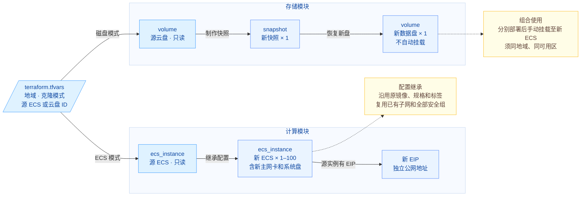

# 快速克隆云服务器与磁盘

本模板提供同地域内的 ECS 配置克隆与单块云盘数据克隆。输入源 ECS ID 和新登录密码，即可沿用原镜像、规格及已有网络创建新实例；输入源云盘 ID，即可通过快照创建一块新数据盘。两种模式可独立使用，也可分别部署后手动挂盘，组成新 ECS 与数据盘的环境。

## 1. 业务背景

基于已有云资源搭建新环境时，通常需要解决以下问题：

- **重复配置实例**：规格、镜像、网络和系统盘参数需要逐项填写，容易与源环境产生偏差。
- **单独复制数据**：只需要某块云盘的数据时，希望直接生成独立的新盘，无需额外创建实例。
- **保留源环境**：新资源应具有独立的实例、磁盘和地址，源 ECS、源盘及已有网络继续使用。

本方案将实例配置克隆和单盘克隆封装为两个模块，通过统一入口选择部署，减少重复配置，并由 Terraform 管理新资源的生命周期。

## 2. 方案概述

整体分为计算与存储两个模块，每次部署选择一种模式：

- **ECS 配置克隆**：读取源实例配置，复用已有子网和安全组，使用原镜像创建 1–100 台新 ECS。源实例绑定 EIP 时，为每台新实例申请独立 EIP。
- **单盘克隆**：为指定源云盘创建快照，再从快照创建一块未挂载的新数据盘，默认继承源盘的容量、类型和可用区。
- **组合使用**：分别部署新 ECS 和新盘，待资源就绪后手动挂载；目标 ECS 与新盘须位于同地域、同可用区。



ECS 模式继承源实例的规格、可用区、原镜像、网络、系统盘规格、计费设置、项目、标签和删除保护。新实例名称自动添加 `-clone-001` 等后缀，使用新密码登录，实例 ID、主网卡、系统盘和私网 IP 均独立生成；新 EIP 使用独立公网地址。

系统盘内容来自原镜像。源实例后续新增的软件、配置和文件，以及当前挂载的数据盘，不会随 ECS 配置克隆复制；原镜像自带的数据盘按镜像定义创建。需要复制指定云盘的数据时，使用单盘克隆模式。辅助网卡、原登录凭据、实例角色、初始化脚本和本地盘数据不在复制范围内。

磁盘模式复制快照时间点已落盘的数据，输出为一块数据盘。创建快照前需完成必要的刷盘或应用一致性准备；模板不会停止源实例、暂停写入或检查数据库一致性。新盘不自动挂载，系统盘快照也不会通过此模式直接生成可启动 ECS。

实例与云盘是否支持复制，以及新资源可用的计费方式，受云服务器产品、地域、规格和资源状态等条件约束，具体以官方文档及实际校验结果为准。

## 3. IaC 设计

### 3.1 资源清单

| Terraform 资源 | 用途 |
| ---------------------------------- | ------------------------------------------------------- |
| `volcenginecc_ecs_instance`        | ECS 模式：创建 `instance_count` 台新 ECS，内嵌创建各自的主网卡、系统盘及可选 EIP |
| `volcenginecc_storageebs_snapshot` | 磁盘模式：为指定源云盘制作 1 份快照                                     |
| `volcenginecc_storageebs_volume`   | 磁盘模式：从新快照创建 1 块未挂载的数据盘                                  |

当前参数文件选择 ECS 模式、数量为 1，但源 ID 和密码仍待填写；填写有效参数后预期新增 1 台 ECS，是否附带 EIP 取决于源配置。选择磁盘模式时则新增 1 份快照和 1 块盘，两种清单不会在同一次部署中同时创建。

标签自动继承，无需填写：新 ECS 继承源 ECS 的标签，新快照和新盘继承源云盘的标签；源没有标签时不传标签。当前版本暂不支持无标签源云盘的快照克隆，请选择带有标签的源云盘使用磁盘模式。

数据源仅读取源 ECS、系统盘、EIP 或源云盘，不计入新建资源。已有 VPC、子网和安全组直接复用；密钥对和自定义镜像不由本模板创建。

### 3.2 工程结构

```text
terraform-volcenginecc-ecs-instance-cloning/
├── modules/
│   ├── compute/             # ECS 配置克隆模块
│   │   ├── main.tf          # 新 ECS、主网卡、系统盘及可选 EIP
│   │   ├── variables.tf     # 源配置及新实例输入
│   │   ├── outputs.tf       # 新实例 ID 与配置信息
│   │   └── versions.tf      # 模块 Provider 与 Terraform 版本要求
│   └── disk/                # 单盘克隆模块
│       ├── main.tf          # 创建快照并恢复新数据盘
│       ├── variables.tf     # 源盘及目标盘配置输入
│       ├── outputs.tf       # 快照 ID、新盘 ID 与配置信息
│       └── versions.tf      # 模块 Provider 与 Terraform 版本要求
├── main.tf                  # 读取源资源，按克隆模式调用模块
├── variables.tf             # 全局输入与参数校验
├── outputs.tf               # 统一输出新资源及复用的网络信息
├── providers.tf             # 单地域 Provider 配置
├── versions.tf              # Terraform >= 1.5.0；volcenginecc = 0.0.71
├── terraform.tfvars         # 用户输入，不保存密码或凭证
├── .gitignore               # 排除状态、计划及本地缓存文件
├── README.md                # 英文说明
└── README.zh-CN.md           # 中文说明
```

模块边界与依赖：

- 根模块负责只读查询源 ECS、源系统盘、源 EIP 或源云盘，并按 `clone_mode` 调用一个子模块。
- `modules/compute` 负责创建新 ECS 及其附属资源，复用源网络，不创建 VPC、子网或安全组。
- `modules/disk` 负责创建快照与新盘；新盘依赖快照可用，挂载由用户在部署后完成。

### 3.3 核心代码示例

根模块按 `clone_mode` 选择子模块。以下为 ECS 模式的编排节选：源规格、原镜像、子网和安全组从源实例读取，新实例数量及登录密码由用户提供。

```hcl
module "compute" {
  count  = local.clone_instance ? 1 : 0
  source = "./modules/compute"

  instance_type      = data.volcenginecc_ecs_instance.source[0].instance_type
  image_id           = data.volcenginecc_ecs_instance.source[0].image.image_id
  subnet_id          = data.volcenginecc_ecs_instance.source[0].primary_network_interface.subnet_id
  security_group_ids = data.volcenginecc_ecs_instance.source[0].primary_network_interface.security_group_ids
  instance_count     = var.instance_count
  password           = var.password
  # 其余源配置输入见 main.tf
}
```

存储模块先创建源盘快照，再通过 `source_snapshot_id` 创建新数据盘。以下为资源关系节选；完整代码还会在创建新盘前检查快照为 `available`，并校验目标盘类型及容量。新盘不自动挂载。

```hcl
resource "volcenginecc_storageebs_snapshot" "this" {
  volume_id     = var.source_volume_id
  snapshot_name = "clone-${var.source_volume_id}"
  # 项目、标签和源盘类型校验见完整代码
}

resource "volcenginecc_storageebs_volume" "this" {
  volume_name        = "clone-${var.source_volume_id}"
  zone_id            = var.zone_id
  volume_type        = var.volume_type
  size               = var.size
  kind               = "data"
  pay_type           = "post"
  source_snapshot_id = volcenginecc_storageebs_snapshot.this.snapshot_id
  # 项目、标签及快照状态和容量校验见完整代码
}
```

### 3.4 参数与输出

按所选模式填写以下参数。默认参数文件启用 ECS 模式、数量为 1，源 ID 保持 `null`，使用前必须替换；密码通过运行环境注入。

| 参数                    | 默认值                | 说明                                                                                                                     |
| --------------------- | ------------------ | ---------------------------------------------------------------------------------------------------------------------- |
| `region`              | `cn-beijing`       | 源资源与新资源所在的同一地域                                                                                                         |
| `clone_mode`          | 必填                 | 选择 `CloneEcsInstance` 或 `CloneEcsDisk`；默认参数文件预填 `CloneEcsInstance`                                                         |
| `source_instance_id`  | `null`             | ECS 模式必填的源实例 ID；磁盘模式无需填写                                                                                               |
| `instance_count`      | `1`                | ECS 模式新建数量，整数，范围 1–100                                                                                                 |
| `password`            | `null`             | ECS 模式必填的敏感新密码，通过 `TF_VAR_password` 传入；长度 8–30，大小写字母、数字、允许的特殊字符中至少包含三类，不能以 `/` 或 `$6$` 开头；|
| `deletion_protection` | `null`             | 仅 ECS 模式：`null` 继承源实例，`true`/`false` 显式覆盖；销毁前需设为 `false` 并 Apply                                                       |
| `source_volume_id`    | `null`             | 磁盘模式必填的源云盘 ID；ECS 模式无需填写                                                                                               |
| `disk_zone_id`        | `null`             | 仅磁盘模式：默认沿用源盘可用区，也可选择同地域其他可用区                                                                                           |
| `disk_volume_type`    | `null`             | 仅磁盘模式：默认沿用源盘类型；支持 `ESSD_PL0`、`ESSD_FlexPL`、`TSSD_TL0`，源盘容量须满足目标类型要求                                                    |

标签和项目归属从源 ECS 或源盘自动继承，不需要额外输入。输出用于查找新资源、核对配置及完成后续手动挂载，均不包含密码：

| 输出                    | 含义                                                  |
| --------------------- | --------------------------------------------------- |
| `clone_mode`          | 当前模式                                                |
| `cloned_instance_ids` | 新 ECS ID 列表；磁盘模式为空                                  |
| `cloned_instances`    | 新 ECS 状态、规格、计费、删除保护、镜像、主私网 IP、网卡、EIP 和磁盘信息；磁盘模式为空列表 |
| `reused_network`      | 复用的 VPC、子网、安全组 ID；磁盘模式为 `null`                      |
| `source_image_id`     | ECS 模式使用的原镜像 ID；磁盘模式为 `null`，不会创建备份镜像               |
| `cloned_volume_id`    | 新数据盘 ID；ECS 模式为 `null`                              |
| `snapshot_id`         | 磁盘模式创建的快照 ID；ECS 模式为 `null`                         |
| `cloned_volume`       | 新盘的状态、可用区、类型、容量及快照来源                                |

EIP 的 `release_with_instance` 是新 ECS 内嵌的 EIP 配置项，未开放为本模板的用户输入，不能在 `terraform.tfvars` 中直接覆盖。该值继承源 EIP，源未返回时取 `false`；可在 `cloned_instances` 各项的 `eip_address` 中查看实际值。`true` 表示 EIP 随 ECS 释放，`false` 表示删除 ECS 后保留 EIP，需要在控制台单独释放。各类资源的清理范围见第 4.2.5 节。

新资源独立计费：包年包月源实例会创建新的包年包月实例，不转移源实例的剩余订购时长；磁盘模式创建按量付费的新数据盘。源订购时长缺失或不受支持时取 `1`，周期单位缺失时取 `Month`；自动续费默认关闭，已开启但续费周期缺失或不受支持时取 1。源 EIP 的带宽、计费方式、线路或释放设置缺失时，分别使用 `1` Mbps、`PayByBandwidth`、`BGP` 和 `false`。部署前请在执行计划中核对订购、续费及公网计费设置。

## 4. 使用说明

本工程支持通过 InfraManager 在云上一键部署或下载模板在本地运行。推荐使用云上部署方式，无需自行准备 Terraform 运行环境，只需在平台填写参数即可完成资源创建和托管。

### 4.1 云上部署

InfraManager 是火山引擎提供的 Terraform 托管工作台，更多产品介绍参见 [InfraManager 产品介绍](https://docs.volcengine.com/docs/infrastructure-management/product-introduction?lang=zh)。

#### 4.1.1 准备权限

为资源栈配置可访问源资源的执行身份，并按所选模式授予权限：

| 场景       | 所需权限                                             |
| -------- | ------------------------------------------------ |
| ECS 配置克隆 | 读取源 ECS、源系统盘及可选源 EIP 的配置；创建、查询、更新和删除新 ECS 及其附属资源 |
| 单盘克隆     | 读取源云盘；创建、查询和删除快照及新云盘                             |
| 组合使用与清理  | 在控制台挂载、解挂新盘；释放不随新 ECS 删除的独立 EIP                  |

将权限限制到实际地域和项目；源资源只需读取权限。还需在控制台确认：源与目标在同一地域，原镜像可用，目标规格有库存，ECS、云盘、快照和可选 EIP 的服务、配额及付费条件满足要求。磁盘模式的源盘须支持快照且至少有一组标签；支持的存储类型见参数表。

#### 4.1.2 选择模板

打开 [InfraManager 控制台](https://console.volcengine.com/iac)，进入 **模板管理 > 公开模板**，搜索“快速克隆云服务器与磁盘”。

#### 4.1.3 创建资源栈

选择模板并点击 **创建资源栈**，根据实际需求填写资源栈信息和模板参数。创建并检查执行计划，确认变更符合预期后，点击 **执行部署**。

创建前重点确认：

- 地域与源资源一致，按第 3.4 节填写所选模式的参数。
- ECS 模式填写源 ECS ID、数量，并通过平台敏感参数提供新登录密码；核对原镜像、复用网络、系统盘及计费配置。源有 EIP 时，还需核对新 EIP 的带宽、计费和释放设置。
- 磁盘模式填写源盘 ID，按需覆盖新盘的可用区和类型。
- 计划中的资源数量及变更范围符合预期，没有意外删除或替换。

部署后保存输出中的新资源 ID。组合使用时，为新 ECS 和每块待复制的盘分别创建资源栈，新盘必须与新 ECS 同地域、同可用区。已部署的资源栈保持原模式；切换模式或减少实例数量会产生删除计划，应先审查影响。

#### 4.1.4 部署验证

在资源栈详情页确认部署成功，再根据模式取得输出并在控制台核对：

| 模式       | 使用的输出                                                                       | 控制台预期结果                                                         |
| -------- | --------------------------------------------------------------------------- | --------------------------------------------------------------- |
| ECS 配置克隆 | `cloned_instance_ids`、`cloned_instances`、`reused_network`、`source_image_id` | 新实例运行中，配置符合源实例及覆盖参数；实例、网卡、系统盘 ID 和 IP 独立生成；源有 EIP 时，新实例使用新的 EIP |
| 单盘克隆     | `snapshot_id`、`cloned_volume_id`、`cloned_volume`                            | 快照可用，新盘可用且未挂载；快照来源为指定源盘，新盘来源为本次新快照                              |

继续按第 4.2.4 节的控制台核对项验证配置、标签、登录及文件。云上部署直接使用各资源栈的输出，无需下载本地 State。组合场景还需按下方流程手动挂载新盘；资源栈部署成功不代表应用已经恢复。

### 4.2 本地部署

您也可以下载本工程模板在本地运行，需要按照下述步骤操作。

以下命令均在模板根目录运行。组合场景须同时确认当前工作区及对应的参数文件。

#### 4.2.1 环境准备

**基础环境**：

- 安装 Terraform >= 1.5.0，使用 `versions.tf` 指定的 `volcengine/volcenginecc` 0.0.71。
- 运行环境需能访问 Terraform Registry 下载 Provider，并访问火山引擎 OpenAPI 读取源资源和创建新资源。

**服务与配额**：

- 在控制台按第 4.1.1 节准备权限、服务、配额、规格库存及原镜像。新 ECS 沿用已有子网和安全组，需具备可用的登录网络路径。
- 磁盘模式要求源盘处于可用或已挂载状态，类型为 `ESSD_PL0`、`ESSD_FlexPL` 或 `TSSD_TL0`，且至少有一组标签。新盘容量继承源盘，须满足目标类型的容量要求：`TSSD_TL0` 至少 40 GiB，其他两种类型至少 10 GiB。
- 创建快照前，完成必要的刷盘或应用一致性准备。

**凭证注入**（推荐环境变量，不要写入代码或 `tfvars`）：

```bash
export VOLCENGINE_ACCESS_KEY="your_access_key"
export VOLCENGINE_SECRET_KEY="your_secret_key"
export VOLCENGINE_REGION="cn-beijing"
```

将占位值替换为实际凭证。`VOLCENGINE_REGION` 与 `terraform.tfvars` 中的 `region` 保持一致；本模板以 `region` 参数指定部署地域。

**敏感业务变量**：`password` 为新 ECS 的登录密码，仅 ECS 模式需要。建议通过环境变量注入，不要写入 `terraform.tfvars`：

```bash
export TF_VAR_password="<your_new_password>"
```

将占位值替换为符合第 3.4 节规则的新密码。后续变更时继续提供同一密码；妥善保管 State 和 Plan 文件，`sensitive` 只隐藏展示，不加密文件。

**重点参数**：完整参数及默认值见第 3.4 节；部署前确认地域、克隆模式及对应源 ID，ECS 模式还需提供新密码。

#### 4.2.2 场景化部署示例

**场景一：克隆 ECS 配置。** 在 `terraform.tfvars` 中启用 ECS 参数块，将示例源 ID 替换为真实 ID：

```hcl
region              = "cn-beijing"
clone_mode          = "CloneEcsInstance"
source_instance_id  = "i-ACTUALSOURCEID"
instance_count      = 1
deletion_protection = null
```

无需填写 VPC、子网、安全组、规格、镜像或标签，它们从源资源读取。新密码按上一节注入。

**场景二：克隆单块云盘。** 在 `terraform.tfvars` 中启用磁盘参数块，将源 ID 替换为真实 ID：

```hcl
region           = "cn-beijing"
clone_mode       = "CloneEcsDisk"
source_volume_id = "vol-ACTUALSOURCEID"
disk_zone_id     = null
disk_volume_type = null
```

`null` 表示沿用源盘可用区和类型。可按需指定同地域其他可用区或支持的存储类型，新盘容量仍继承源盘。当前版本无标签源盘的快照创建可能失败，请使用带有标签的源盘。

选择一种模式并准备好参数后，执行：

```bash
terraform init
terraform fmt -check -recursive
terraform validate
terraform plan -out=clone.tfplan
```

审查 Plan，确认新增资源及计费符合预期，再执行保存的计划：

```bash
terraform apply clone.tfplan
terraform output
```

每个已部署的工作区固定一种模式。已有部署变更前，先核对现有资源与 State；切换模式或减少 `instance_count` 会计划删除旧模式资源或多余实例。

##### 组合流程：新 ECS 使用复制后的数据盘

使用同一模板目录、独立 Terraform 工作区和显式参数文件。将上面的 ECS、磁盘参数分别保存为 `ecs.tfvars`、`disk.tfvars`；替换源 ID，并让新盘与目标 ECS 同地域、同可用区。`terraform.tfvars` 仍会自动加载，`-var-file` 覆盖其中的同名参数，因此也应核对根参数文件。

**步骤 1：** 完成快照前的数据准备，创建磁盘工作区并部署：

```bash
terraform init
terraform workspace new clone-disk-01
terraform plan -var-file=disk.tfvars -out=disk.tfplan
terraform apply disk.tfplan
terraform output -raw cloned_volume_id
```

**步骤 2：** 注入新 ECS 密码，创建独立的 ECS 工作区并部署：

```bash
terraform workspace new clone-ecs
terraform plan -var-file=ecs.tfvars -out=ecs.tfplan
terraform apply ecs.tfplan
terraform output -json cloned_instances
```

**步骤 3：** 在云盘控制台按新盘 ID 找到资源，确认与新 ECS 同地域、同可用区，再挂载到新 ECS。两种模式没有严格先后依赖，也可以先创建 ECS；手动挂载前双方资源必须就绪。

**步骤 4：** 在新 ECS 内按云盘 ID 或设备序列号确认设备，识别已有分区和文件系统，先以只读方式挂载并检查代表性文件。已有文件系统的克隆盘不要重新分区、初始化或格式化。条件参见 [云盘使用说明](https://docs.volcengine.com/docs/ecs/Create-a-volume?lang=zh)。

**步骤 5：** 文件及恢复点确认后，再配置挂载目录、权限、开机挂载和应用数据路径，验证业务读写。

多块盘分别使用 `clone-disk-02` 等独立工作区和各自参数文件重复部署。已有工作区使用 `terraform workspace select` 切换；每次 Plan 和销毁均使用对应的 `-var-file`。该流程不会复制源系统盘当前新增的软件和配置。

#### 4.2.3 部署预期结果

使用 `terraform output` 查看当前工作区结果；组合场景分别切换到 ECS、磁盘工作区查看。

| 模式       | 预期新增资源                                                           | 关键输出                                                                        |
| -------- | ---------------------------------------------------------------- | --------------------------------------------------------------------------- |
| ECS 配置克隆 | 默认 1 台 ECS；数量由 `instance_count` 决定，每台有新主网卡和系统盘；源有 EIP 时每台另有新 EIP | `cloned_instance_ids`、`cloned_instances`、`reused_network`、`source_image_id` |
| 单盘克隆     | 1 份快照、1 块未挂载新数据盘，不创建 ECS                                         | `snapshot_id`、`cloned_volume_id`、`cloned_volume`                            |

新 ECS 名称带 `-clone-001` 等后缀；系统盘内容来自原镜像。两种模式均不创建新网络，不改变源实例配置或改写源盘内容。完整输出含义见第 3.4 节。

#### 4.2.4 部署后验证

根据第 4.2.3 节的输出记录新资源 ID，进入火山引擎控制台，切换到部署地域，分别查看源资源与克隆资源。

**ECS 配置克隆**：在 ECS 控制台的实例列表中，按 `cloned_instance_ids` 找到新实例，进入实例详情核对：

| 检查位置 | 核对内容 | 预期结果 |
| --- | --- | --- |
| 实例列表与基本信息 | 数量、状态、名称、规格、可用区、项目和标签 | 数量与 `instance_count` 一致，状态为运行中；名称带 `-clone-001` 等后缀，规格及归属信息符合源配置 |
| 镜像与云盘信息 | 镜像 ID、系统盘类型及容量 | 使用源实例的原镜像，系统盘类型及容量与源系统盘一致；系统盘 ID 为新 ID |
| 网络信息 | VPC、子网、安全组、主网卡和私网 IP | VPC、子网及安全组与源实例一致；主网卡和私网 IP 为新分配 |
| 公网信息 | EIP 地址、带宽、计费方式及 `release_with_instance` | 源实例有 EIP 时，新实例使用独立 EIP；配置符合执行计划，释放标记与 `cloned_instances` 输出一致 |
| 计费与删除保护 | 计费类型、订购和续费设置、删除保护 | 与源配置及本次执行计划一致，删除保护符合覆盖参数 |

使用本次提供的新密码，通过已准备的网络路径登录新 ECS，确认登录成功；仅部署 ECS 模式时也需完成此检查。连接失败时，先检查目标地址、网络连通性、安全组、实例防火墙及登录账号，再核对密码。

**单盘克隆**：在云盘和快照列表中，分别按 `cloned_volume_id`、`snapshot_id` 找到新资源，进入详情核对：

| 检查位置 | 核对内容 | 预期结果 |
| --- | --- | --- |
| 快照详情 | 状态、源盘 ID、项目和标签 | 快照可用，源盘为 `source_volume_id` 指定的云盘，项目和标签继承源盘 |
| 新盘详情 | 状态、来源快照、容量、类型、可用区、项目和标签 | 新盘可用，来源为本次创建的快照；容量继承源盘，类型和可用区符合输入，项目和标签继承源盘 |
| 挂载信息 | 关联实例 | 独立部署后新盘未挂载；组合使用时，手动挂载后关联目标新 ECS |

最后查看源 ECS 和源盘，确认源实例状态及原有挂载关系正常。若目标配置与预期不符，先核对源 ID、输入参数和执行计划。

控制台可核对配置和快照来源，盘内文件需挂载后检查。组合使用时按第 4.2.2 节挂载新盘，登录新 ECS，核对代表性目录、文件和恢复时间点，再验证业务读写。ECS 配置克隆的系统盘来自原镜像，不包含源实例后续新增的软件、配置和文件。

#### 4.2.5 销毁资源

销毁前确认当前工作区及待删除资源。组合使用时，先停止使用新盘的应用，卸载文件系统并在控制台解挂新盘；新 ECS 启用删除保护时，将 `deletion_protection` 设为 `false`，执行 `terraform plan` 和 `terraform apply`，确认变更生效后再销毁。

```bash
terraform plan -destroy
terraform destroy
```

检查删除计划，确认后按提示输入 `yes`。

注意事项：

- 组合场景分别切换到 ECS 和磁盘工作区；预览和销毁均使用对应参数文件。例如磁盘工作区执行 `terraform plan -destroy -var-file=disk.tfvars` 和 `terraform destroy -var-file=disk.tfvars`，ECS 工作区使用 `ecs.tfvars`，关闭删除保护时也使用该文件。

删除 ECS 不等于清理所有克隆资源。按资源所属工作区或资源栈分别销毁，并核对：

| 资源 | 清理行为 | 需要人工确认的内容 |
| --- | --- | --- |
| 新 ECS、主网卡和系统盘 | 销毁 ECS 模式的工作区或资源栈；主网卡及系统盘随实例释放，系统盘固定配置 `delete_with_instance = true` | 删除保护已关闭，实例、主网卡和系统盘均已释放 |
| 新 EIP | 按第 3.4 节的 `release_with_instance` 设置决定是否随 ECS 释放 | 销毁前记录 `cloned_instances` 中各新 EIP 的分配 ID；为 `false` 时，在 EIP 控制台按这些 ID 确认解绑后单独释放，勿选择源 EIP |
| 单盘模式的新数据盘和快照 | 由磁盘模式的独立工作区或资源栈管理，销毁时先删除新盘，再删除快照；删除 ECS 不会清理它们 | 新盘已卸载并解挂；对应磁盘工作区或资源栈销毁后，新盘和快照均已清理 |
| 原整机镜像自带的数据盘（如有） | 按云平台创建后的实际释放属性处理，本模板未单独指定其释放策略 | 在实例及云盘详情中核对关联和释放属性；删除实例后若仍保留，确认无需数据后单独清理新盘 |

源 ECS、源盘、源 EIP、原镜像及原快照、复用的 VPC、子网和安全组不在销毁范围。销毁后在控制台确认新资源已清理；部分失败时保留 State，核对剩余资源后重试。

云上部署在对应资源栈中完成相同的删除保护变更及销毁操作。

## 5. 总结

本模板通过统一入口提供两种克隆能力：

- **减少重复输入**：新 ECS 自动继承源规格、原镜像、已有网络及资源归属，用户只需提供源实例和新密码，并按需调整数量。
- **按需复制数据**：单独复制指定云盘，或将新盘手动挂载到新 ECS，满足单盘复制和实例配盘两类需求。
- **统一管理新资源**：通过 Terraform 管理创建、变更与销毁，源实例、源盘及已有网络保持独立。

使用时应根据复制范围选择模式，并在部署后完成登录、文件恢复点和业务读写验证。
